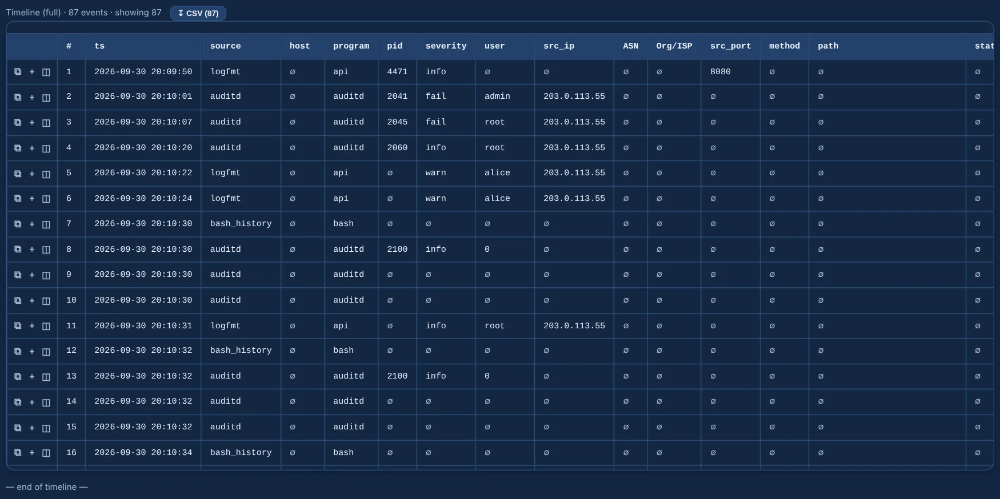

<div align="center">

# 🌭 Longanizer

**Forensic Linux log analyzer — parse once, query with SQL, hunt with Sigma.**

Drop in the logs you pulled from a box, open the browser, and investigate: one timeline in UTC,
full‑text and field search, Sigma detections, GTFOBins with privilege context, network
connections, IOCs, triage marks and a one‑click case report. **Runs 100% locally and offline.**


</div>

---

<p align="center">
  
</p>

<p align="center">
  <b>📚 Documentation: <a href="https://g92mz.github.io/longanizer/">g92mz.github.io/longanizer</a></b><br>
  <sub>every tab and log format explained, with screenshots</sub>
</p>

## 🚀 Quickstart

Python **3.11+** with `pip`, on Windows, Linux or macOS.

```bash
pip install -r requirements.txt
python run.py                 # then open http://127.0.0.1:8000 (or http://<this-pc-ip>:8000)
```

`python run.py` checks for updates on every start (`python update.py` does it on demand), keeping
your cases and GeoIP data. Options, loading, time zones and cases in
[Getting started](https://g92mz.github.io/longanizer/getting-started/).

## ✨ What it does

- 🧩 **Many log types** — auth, syslog / kern / cron, web access and error, auditd, bash_history, logfmt, CSV, dmesg, apt / dpkg, fontconfig, udev — detected automatically, even rotated or inside archives.
- 🔎 **Search** — one query language shared with WinHound (`field=value` equal, `field:value` contains, `AND` / `OR` / `NOT`), facets, and click a cell to filter by it.
- 🧬 **auditd enrichment** — EXECVE stitched into full command lines, hex and `saddr` decoded.
- 🛡️ **Sigma** — Linux and web-server rules with what matched, correlation, and the case's ATT&CK coverage.
- 🪤 **GTFOBins** — binaries that actually ran, cross-referenced with the catalogue and their privilege context.
- 🌐 **Network and IOCs** — who talked to whom, indicators discovered in the data, and a sweep for the ones you paste; GeoIP / ASN for public IPs.
- 📌 **Triage and report** — mark events, then export a self-contained HTML case report.
- 🤖 **AI and MCP** — ask about the case through your AI provider, a local model or an MCP client, read-only.

## 🧪 Samples

`sample_logs/` holds a coherent intrusion — SSH brute force → web shell → download and run →
sudo escalation — that lights up the example Sigma rules in `reglas_sigma/` and GTFOBins.

## 📝 Principles

- **Local and offline** — no cloud and no outbound calls, except the GTFOBins catalogue (downloaded on the first start, then offline), the optional GeoIP download and the AI endpoint you configure.
- **Your data stays yours** in `casos/`, `geoip_data/` and `gtfobins_data/`, git-ignored and kept across updates.
- **No login** — the web UI has no authentication; keep it on a trusted network or use `--host 127.0.0.1`.
- The Python package is named `loganalyzer`; the app is **Longanizer**.

## 📜 License

Licensed under the **Apache License 2.0** — see [`LICENSE`](LICENSE) and `NOTICE`.

© 2026 Gregorio Moreno (**gmzpt**)
