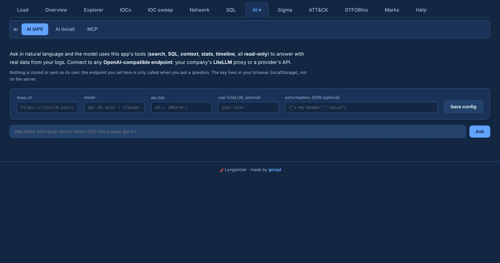
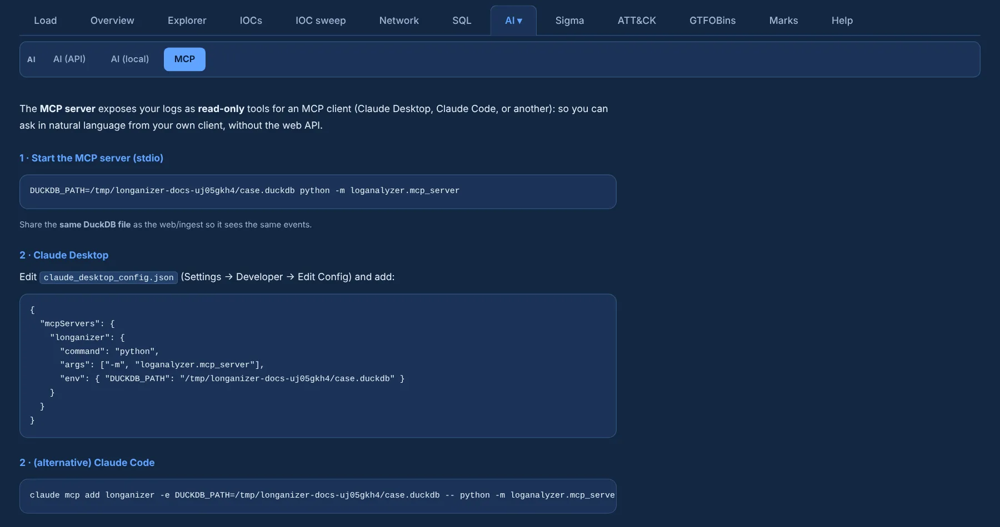

# AI and MCP

Three tabs under **AI ▾** let a language model read the case — always through **read-only** tools.

## AI (API) and AI (local)

Ask in natural language ("which IPs brute-forced SSH and did any of them get in?"); the model answers
by calling Longanizer's tools: **search, SQL, context, stats and timeline**.

{ .shot }

- **AI (API)** connects to any **OpenAI-compatible endpoint**: your company's LiteLLM proxy or a
  provider. Fill in `base_url`, `model`, `api_key`, and optionally a `user` (for LiteLLM) and extra
  headers as JSON.
- **AI (local)** does the same against a local app such as Ollama or LM Studio, so the data never
  leaves your machine.
- Settings, including the key, are stored **only in your browser**.

## MCP

The **MCP** tab exposes the same read-only tools to an MCP client (Claude Desktop, Claude Code or
another), so you can ask from your own client without the web UI. The tab shows the commands and
the config ready to copy, already pointing at the case file in use.

{ .shot }

```bash
DUCKDB_PATH=/path/to/case.duckdb python -m loganalyzer.mcp_server       # stdio server
claude mcp add longanizer -e DUCKDB_PATH=/path/to/case.duckdb -- python -m loganalyzer.mcp_server
```

For Claude Desktop, add it to `claude_desktop_config.json` (Settings → Developer → Edit Config):

```json
{
  "mcpServers": {
    "longanizer": {
      "command": "python",
      "args": ["-m", "loganalyzer.mcp_server"],
      "env": { "DUCKDB_PATH": "/path/to/case.duckdb" }
    }
  }
}
```

The MCP server must share the **same DuckDB file** as the web UI, so load into a saved case
(or start with `--db`) first. Its tools are `buscar_logs` (search), `consulta_sql`, `contexto`,
`estadisticas` and `ver_timeline`. It needs the optional `mcp` package (1.x). The CLI starts it too: `python -m loganalyzer.cli mcp --db case.duckdb`.
