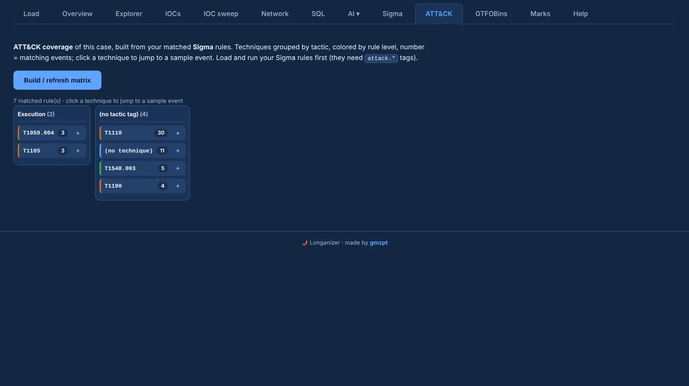

# ATT&CK matrix

The **ATT&CK** tab builds MITRE ATT&CK coverage **from the case itself**: it takes the Sigma rules
that matched and places their techniques on the matrix, so you see which tactics the activity in
these logs touched.

{ .shot }

- **Columns are tactics**; techniques sit under their tactic.
- Each technique is **coloured by rule level** (critical / high / medium / low), and the number is
  the count of matching events.
- **Click a technique** to jump to a sample matching event; its **+** sends a sample of that
  technique to [review](../investigate/marks-report.md) with a 10-event frozen context.

Rules need `attack.*` tags, and you need to load and run them in the [Sigma](sigma.md) tab first —
no tagged matches, no cells. Then **Build / refresh matrix** and read it top-down: the coloured,
high-count techniques are where the case's activity concentrated.
