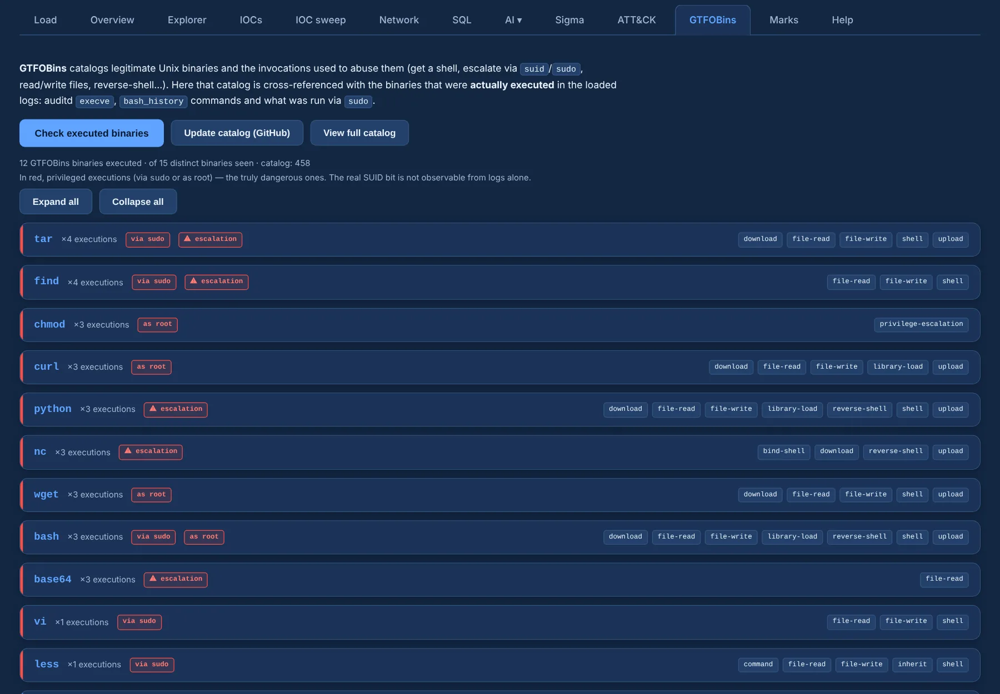

# GTFOBins

**GTFOBins** catalogues legitimate Unix binaries and how they are abused — shells, file read and
write, privilege escalation, downloads. Longanizer cross-references that catalogue with what was
**actually executed** in the logs.

{ .shot }

## Check executed binaries

**Check executed binaries** looks at:

- auditd `execve`;
- `bash_history`;
- what was launched through `sudo`;
- the real binary inside **appliance shell logs** (`/var/log/sh.log`, `/var/log/bash.log`), where
  commands are wrapped as `sh_command="…"` or `shell_command="…"`.

You get one card per binary with its techniques, abuse examples and contexts, and the log lines
where it ran.

## Privilege context

Each binary is tagged with how it ran, the dangerous ones first and in red:

| Tag | Means |
|---|---|
| **via sudo** | launched with sudo |
| **as root** | euid / uid 0 |
| **⚠ escalation** | euid 0 with a non-root login (`auid`) |
| **appliance shell** | run from the appliance shell, a privileged context |

The real SUID bit can't be observed from logs alone.

## Where it ran

Each card lists up to **200** examples; when there are more, the header says *showing N of TOTAL*
and **See all N** loads every hit. Each row jumps to its context and carries ⧉ copy and the mark
buttons.

## The catalogue

A snapshot of the catalogue ships in `gtfobins_data/gtfobins.json`, so the check works out of the
box and offline. **Update catalog (GitHub)** refreshes it (with `git`, or a tarball download when
git is missing). **View full catalog** lists every binary with a filter.
