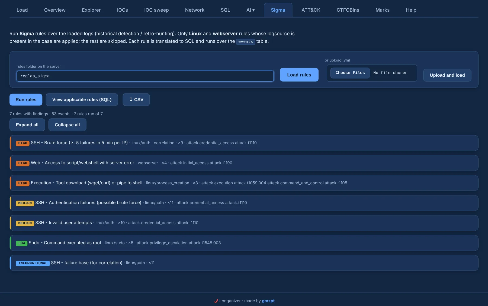

# Sigma

The **Sigma** tab runs Sigma rules over the loaded logs (retro-hunting). Six example rules ship in
`reglas_sigma/` — SSH brute force and invalid users, web-shell access, download and execute, sudo
to root, and an SSH brute-force correlation — and you can add your own.

Drop `.yml` files in `reglas_sigma/` (or give another folder on the server, or upload them), press
**Load rules** (with a progress bar, file by file) and **Run rules** (with a live progress bar).

{ .shot }

## Which rules apply

Only **Linux** and **web server** rules whose log source is present in the case are applied; the
rest are skipped with a reason.

| Log source | Events |
|---|---|
| `linux` / `process_creation` | auditd `execve` |
| `linux` / `network_connection` · `file_event` | auditd connects · auditd path / open / create / unlink |
| `linux` / `auditd` | auditd |
| `linux` / `auth` · `sshd` · `sudo` | `auth` (by program) |
| `linux` / `cron` · `syslog` | `cron` · `syslog` and `kern` |
| `linux` / `clamav` · `vsftpd` · `guacamole` | `syslog` by program |
| `webserver` (Apache, Nginx) | `access` |
| `modsecurity` | `weberror` |

**Correlation** rules (`event_count`, `value_count`, `temporal`) are supported.

## Findings

Findings are grouped by rule, with level and ATT&CK tags; **Expand all** / **Collapse all**. Expand
a rule to see:

- the matching events, with a **what matched** column (keywords highlighted);
- the **rule content (YAML)** next to its hits;
- per hit, **⧉ copy**, **view structured raw** (the full line or JSON under the row) and the
  **mark** / **＋ add to review** buttons. Clicking a hit jumps to its context in the Explorer.

**View applicable rules (SQL)** shows each rule with its equivalent SQL and YAML side by side, and
**↧ CSV** exports the findings. The matched rules also feed the [ATT&CK matrix](attack.md).

Needs the optional `pysigma` package; without it the tab says so and everything else works.
