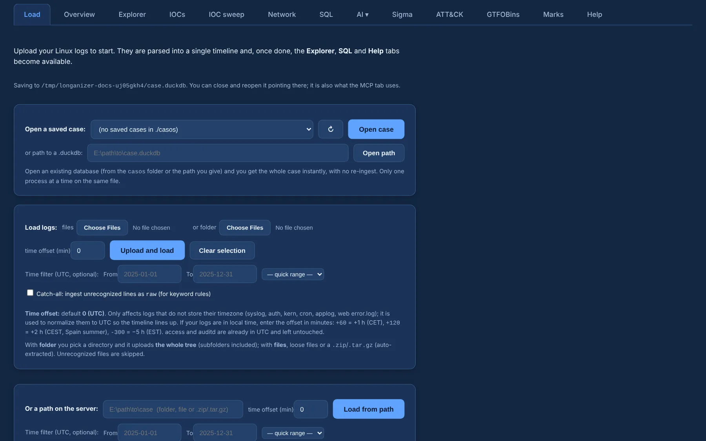

# Getting started

## Install

You need **Python 3.11+** with `pip`, on Windows, Linux or macOS.

```bash
git clone https://github.com/G92MZ/longanizer
cd longanizer
pip install -r requirements.txt
```

Three packages are optional and only switch on their own tabs:

| Package | Enables |
|---|---|
| `pysigma` | the Sigma tab |
| `maxminddb` | country, ASN and ISP of public IPs (GeoIP) |
| `mcp` | the MCP server |

## Run

```bash
python run.py                    # http://127.0.0.1:8000 on this machine
```

On start, `run.py` prints where to open it: `http://127.0.0.1:8000` on this machine and
`http://<this-pc-ip>:8000` from another one on the network.

The **first start** also downloads the [GTFOBins](detection/gtfobins.md) catalogue from GitHub.
Without network it says so and starts anyway; fetch it later with **Update catalog** in the
GTFOBins tab.

| Option | What it does |
|---|---|
| `--port 8001` | another port — run it next to WinHound |
| `--host 127.0.0.1` | only reachable from this machine (the default listens on all interfaces) |
| `--db case.duckdb` | keep the case in that file (same as `DUCKDB_PATH=case.duckdb`) |
| `--no-update` | skip the update check on start |
| `--yes` | install an available update without asking |

The environment variables `HOST`, `PORT` and `DUCKDB_PATH` work too; the arguments win.

!!! warning "No login"
    The web UI has no authentication. Anyone who can reach the port can see the loaded case,
    upload files, run SQL and use the AI tab with your settings. Use `--host 127.0.0.1`, a
    firewall rule, or an SSH tunnel (`ssh -L 8000:127.0.0.1:8000 host`) outside a trusted network.

## Load logs

{ .shot }

The **Load** tab has three ways in:

- **Upload** files, a whole **folder** (the entire tree) or a `.zip` / `.tar.gz` / `.gz` —
  archives are extracted and walked automatically.
- **Server path** — a folder, file or archive already on the machine running Longanizer. It is
  faster (no browser upload) and shows **live progress by bytes**, so the bar moves even inside
  one large file.
- **Open a saved case** — reopen a `.duckdb` from `casos/` instantly, without ingesting again.

Each file's type is detected automatically — see [Log formats](log-formats.md). A few options
matter at load time:

- **Time offset (min)** — for logs that don't store their time zone (syslog, auth, kern, cron,
  applog, web `error.log`): `+120` = CEST, `+60` = CET, `-300` = EST. Default 0 = UTC.
- **Time filter (UTC)** — only ingest a window (`from` / `to`, or a quick range: last 24 h, 3, 7,
  30 or 90 days).
- **Catch-all** — also ingest unrecognized non key=value lines as `raw` (nothing is lost; adds
  noise; handy for keyword Sigma rules).

Only text logs are accepted; a binary file is rejected.

!!! tip "Try it with the sample incident"
    `sample_logs/` holds a coherent intrusion — SSH brute force → web shell → download and run →
    living off the land → sudo escalation — that lights up the example Sigma rules in
    `reglas_sigma/` and GTFOBins. Point **Server path** at the folder.

### From the command line

```bash
python -m loganalyzer.cli detect /evidence/var/log            # show the detected type per file
python -m loganalyzer.cli ingest /evidence/var/log --tz 120 --db case.duckdb
python -m loganalyzer.cli stats --db case.duckdb
python -m loganalyzer.cli sql "SELECT source, count(*) FROM events GROUP BY 1" --db case.duckdb
python run.py --db case.duckdb
```

`ingest` also takes `--type` (force a type), `--year` (base year for syslog lines without one)
and `--user` (owner of a `bash_history`). The Python package is named `loganalyzer`.

## Cases

Each case is one **DuckDB file** under `casos/` (created on the first load, named with a
timestamp) or the one you pin with `--db`. It holds the events, the raw lines and your
[marks](investigate/marks-report.md), so you can close the app and reopen the case later.
`casos/` is git-ignored.

## Update

`run.py` checks GitHub for a new version on every start and asks before installing it. To do
it on demand:

```bash
python update.py            # check and update (asks first)
python update.py --check    # only check
python update.py --yes      # update without asking
```

The updater replaces the app files and **keeps your cases, GeoIP databases and GTFOBins catalogue** (`casos/`,
`geoip_data/`, `gtfobins_data/`). Cloned with git? `git pull` works too.
