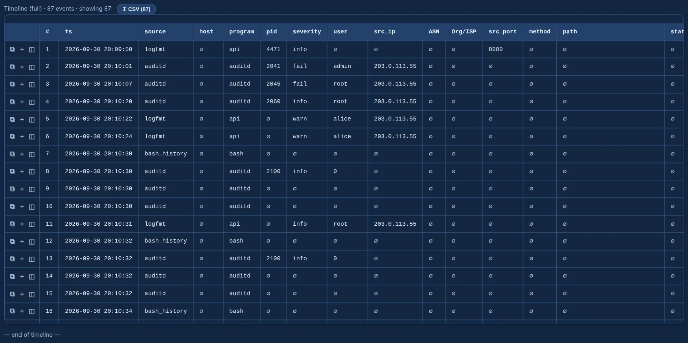

---
hide:
  - navigation
---

# Longanizer

**Forensic Linux log analyzer — parse once, query with SQL, hunt with Sigma.**

Drop in the logs you pulled from a box — auth, syslog, web access and error logs, auditd,
bash history, logfmt, CSV and more, even inside archives — and investigate in the browser:
one normalized timeline in UTC, full-text and field search, Sigma detections, GTFOBins with
privilege context, network connections, IOCs, triage marks and a one-click case report.
**Everything runs locally and offline.**

{ .shot }

-   :material-rocket-launch-outline:{ .lg .middle } **Getting started**

    ---

    Install it, run it, load the sample incident that ships with it.

    [:octicons-arrow-right-24: Getting started](getting-started.md)

-   :material-file-document-multiple-outline:{ .lg .middle } **Log formats**

    ---

    What it recognizes, how each format becomes events, and time zones.

    [:octicons-arrow-right-24: Log formats](log-formats.md)

-   :material-magnify:{ .lg .middle } **Investigate**

    ---

    [Explorer and timeline](investigate/explorer.md) · [Overview and GeoIP](investigate/overview.md) ·
    [IOCs and IOC sweep](investigate/iocs.md) · [Network](investigate/network.md) ·
    [SQL](investigate/sql.md) · [Marks and report](investigate/marks-report.md)

-   :material-shield-search:{ .lg .middle } **Detection**

    ---

    [Sigma](detection/sigma.md) · [ATT&CK matrix](detection/attack.md) ·
    [GTFOBins](detection/gtfobins.md)

-   :material-code-tags:{ .lg .middle } **One query language**

    ---

    `field=value` equal, `field:value` contains, `AND` / `OR` / `NOT`, wildcards, ranges —
    the same in WinHound. [:octicons-arrow-right-24: Query language](reference/query-language.md)

-   :material-earth-off:{ .lg .middle } **Local and offline**

    ---

    No cloud and no outbound calls, except the GTFOBins catalogue download, the optional GeoIP
    download and the AI endpoint you configure yourself.

## What every case gives you

| | |
|---|---|
| **Timeline** | every source normalized into one `events` table in UTC — common columns, source-specific fields in `extra`, the original line in `raw` |
| **Search** | free text and fields with one query language, facets, a cheatsheet and field autocomplete; click any cell to filter by its value |
| **Detections** | your Sigma rules (Linux and web server) with what matched and the rule YAML, ATT&CK coverage, and GTFOBins for the binaries that actually ran |
| **auditd enrichment** | records stitched by serial: EXECVE becomes a full command line, hex arguments and `saddr` decoded |
| **Network and IOCs** | who talked to whom from SSH, web, auditd and firewall logs; indicators discovered in the data, and a sweep for the ones you paste |
| **Triage and report** | pending / TP / FP / dismissed marks with notes and frozen context, and a self-contained HTML report |
| **AI and MCP** | ask about the case through your AI provider, a local model or an MCP client — read-only |

!!! info "About the screenshots"
    Every picture on this site comes from the **sample incident** in `sample_logs/` (an SSH brute
    force, a web shell, a tool download and a sudo escalation, with documentation IP ranges) and
    the example rules in `reglas_sigma/`, taken by `python scripts/docs_screenshots.py`.
    None of them shows a real case.
