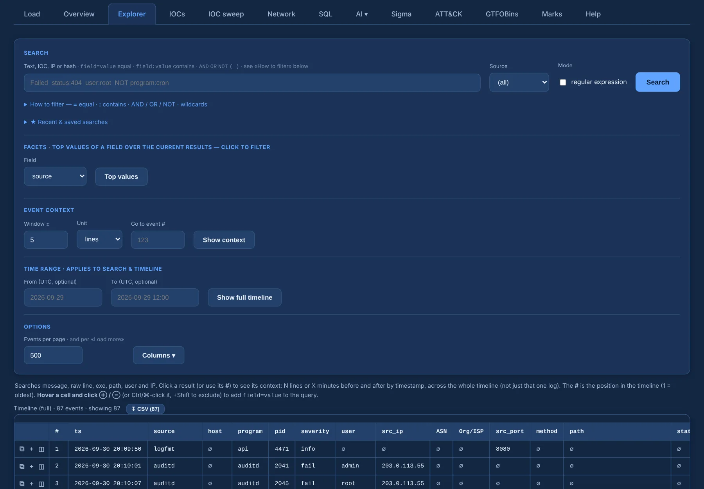
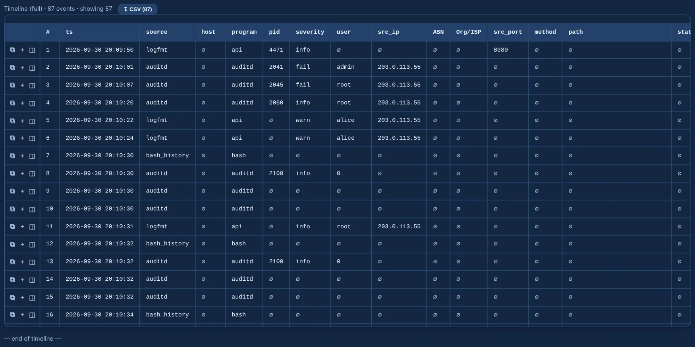
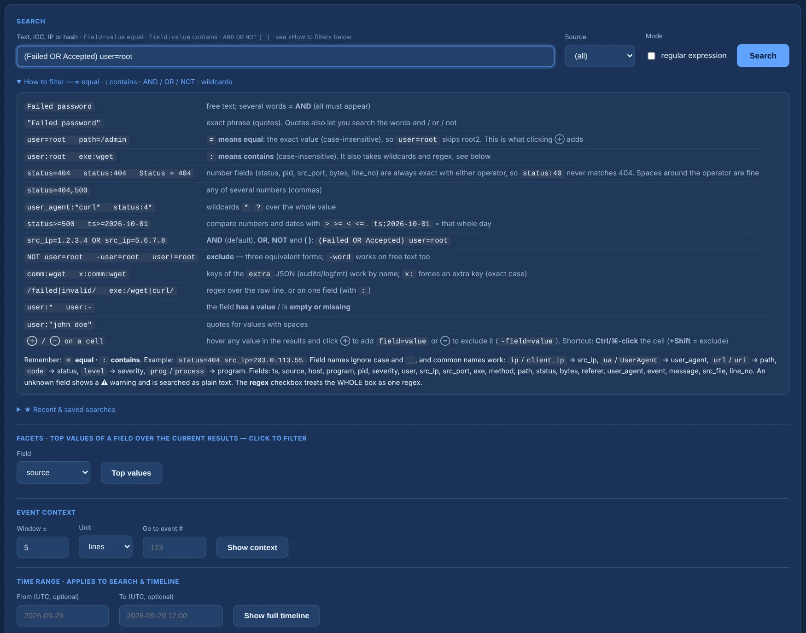
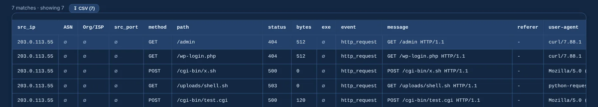
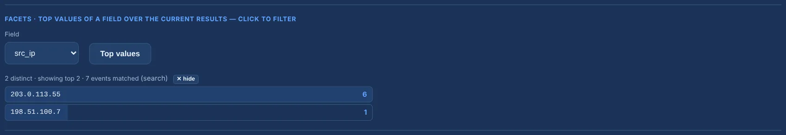
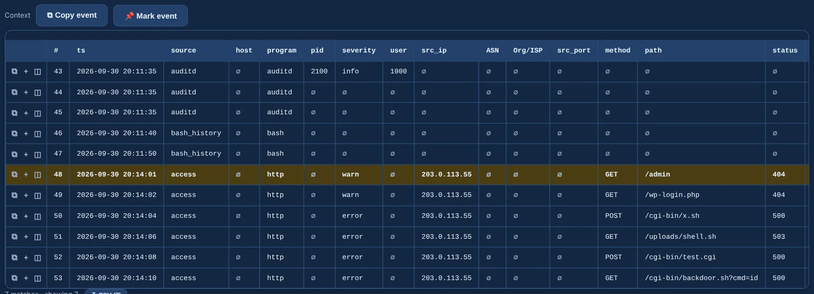
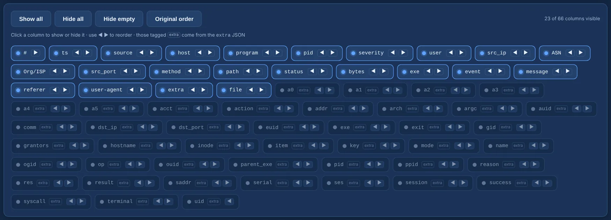

# Explorer and timeline

The Explorer is where you read the case: the **full timeline** of every source, or the events that
match a **search**, in one table.

{ .shot }

## Timeline

**Show full timeline** lists every event in time order, 500 per page (**Load more** brings the
next page; change the page size under **Options**). Each row carries a **#** — its position in the
timeline, `#1` being the oldest.

{ .shot }

The **source** dropdown (`(all)`, `auth`, `access`, `auditd`…) and the **Time range** (From / To,
UTC, like `2026-09-29` or `2026-09-29 08:00`) narrow both the timeline and the search.

## Search

Type any text — an IP, a hash, a path, a piece of a command — or use fields:

```text
Failed password
status>=400 src_ip:203.0.113.
(Failed OR Accepted) user=root NOT src_ip:10.
```

The essentials:

- **`field=value` means equal** (exact, case-insensitive) and **`field:value` means contains**.
  Number fields such as `status`, `pid`, `src_port` or `bytes` are exact with either one, so
  `status:40` never matches 404.
- Words separated by spaces are **AND**; there are **OR**, **NOT** and parentheses too.
- Keys of the `extra` JSON (auditd, logfmt, CSV) work by name (`comm:wget`).
- An unknown field shows a ⚠ warning instead of returning nothing in silence, and a malformed
  query says what is wrong.

Free text searches the message, the raw line, `exe`, `path`, `user` and the IP. The full syntax is
in the [query language reference](../reference/query-language.md). Under the box, **How to filter**
opens a cheatsheet, and the box **autocompletes field names** — including the `extra` keys found in
the case:

{ .shot }

The **regular expression** checkbox treats the whole box as one regex instead.

**Recent & saved searches** keeps your last queries and the ones you name (stored in this browser).

## Filter from a cell

Hover any value in the results and click **⊕** to add `field=value` to the query, or **⊖** to
exclude it (`-field=value`). The search re-runs at once. Shortcut: **Ctrl/⌘-click** the cell,
with **Shift** to exclude. Values with spaces are quoted for you and empty cells become `field:-`.

{ .shot }

## Facets

Pick a field and click **Top values** to see its most frequent values over the current view —
the whole timeline or the current search. Click one to add it to the query. Categorical fields
(`user`, `src_ip`, `status`, `source`, `program`, `asn`, `org`…) are the useful ones.

{ .shot }

## Context

Click a row to see the events around it on the whole timeline — not just that log: **± N lines**
or **± N minutes** (decimals allowed: 0.5 = 30 s). **Go to event #** jumps to a position directly.

{ .shot }

Every row has three buttons:

- **⧉** copies the **full event** — the raw line, or the JSON for auditd records — not just the
  truncated cells;
- **＋** adds the event to your [marks](marks-report.md) as *pending*;
- **◫** opens the **structured event** to read and copy the whole record.

The context header also has **Copy event** and **Mark event**.

## Columns

**Columns** opens a panel of chips: every column, on or off with a click, **Show / Hide all**,
**Hide empty**, reorder with ◀ ▶ and back to the **original order**. The keys of the `extra` JSON
appear tagged *extra* and start hidden. Sort by clicking a header (the server sorts the whole set).

{ .shot }

Two GeoIP columns, **ASN** and **Org/ISP**, are filled from the first IP of each row once the ASN
database is downloaded (see [Overview](overview.md)). They only fill for public IPs.

Only visible columns are rendered and long cells are truncated (the full value is on hover), so
the table stays fast with many events. **↧ CSV** exports the loaded rows.

!!! note "Display limit"
    The browser struggles above roughly 400,000 rendered rows. That is a display limit only:
    search, Sigma and SQL always run over the whole case — page through the view.
