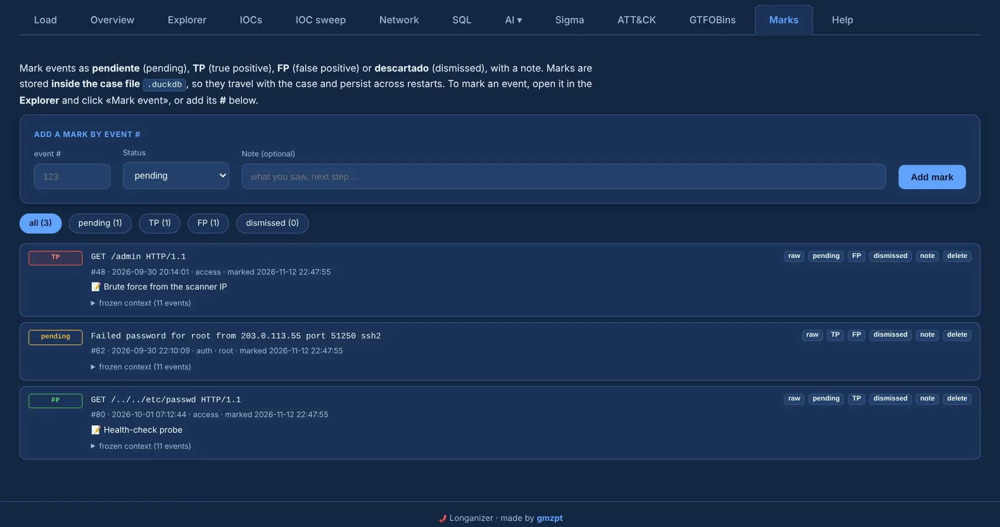
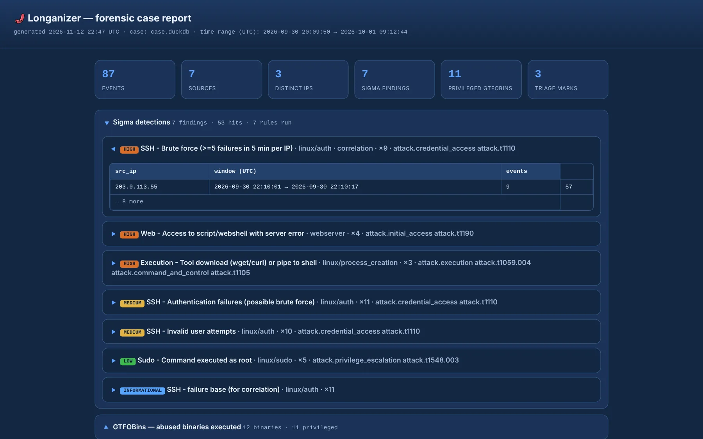

# Marks and report

## Marks

Triage events as **pending**, **TP**, **FP** or **dismissed**, with a note. Marks are stored
**inside the case `.duckdb`**, so they travel with the case and survive restarts.

{ .shot }

Ways to mark an event:

- **＋ add to review** on any row — Explorer, timeline, context, Sigma findings, IOC sweep, Network,
  GTFOBins — files it as *pending* in one click, so you build a "to review" pile while you hunt;
- the **mark** buttons next to ⧉ copy and *view structured* in every detection view, and the
  **+** on each ATT&CK technique;
- **Mark event** in an event's context, or by event `#` in the Marks tab.

A mark made from a detection **freezes a context of the 10 surrounding events** plus the rule or
source that produced it, so the triage record stays self-contained. In the Marks tab, filter by
status, change it, edit the note, open the raw event or jump to its context, and delete a mark
(with confirmation).

## Report

From the [Overview](overview.md), **HTML report** / **Download report** builds a single
self-contained HTML file of the case: summary tiles, Sigma detections with their matches, abused
GTFOBins with their privilege context, top IPs with GeoIP and the triage marks. Sections are
collapsed by default so it reads cleanly, and it prints well.

{ .shot }
