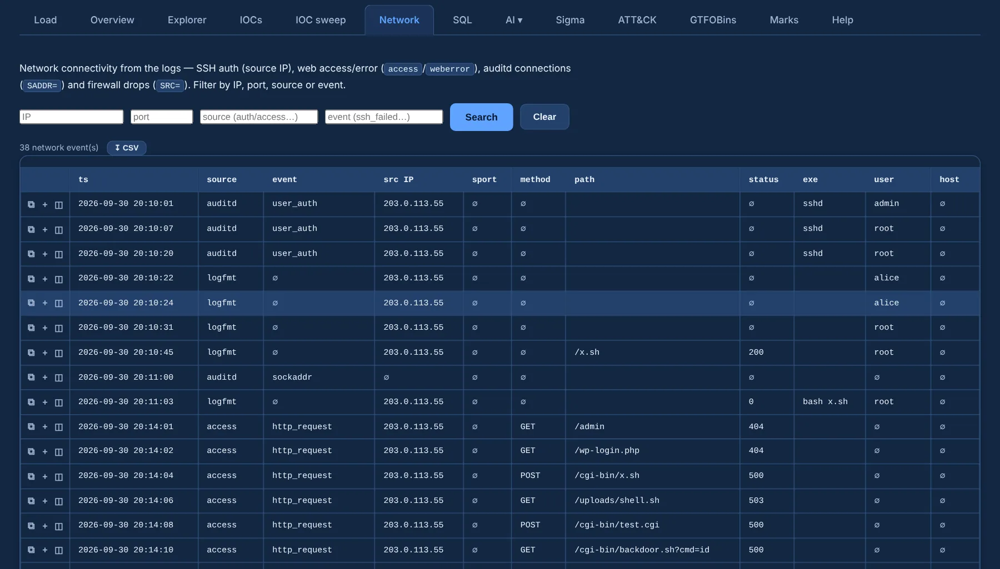

# Network

**Network** rebuilds who talked to whom from the places where IPs and ports surface in Linux logs:

| Source | What |
|---|---|
| SSH (`auth`) | source IP of logins and failed attempts |
| Web (`access`, `weberror`) | client access and server errors |
| auditd | `connect` / `accept` with the decoded `saddr` |
| Firewall (`kern`, `syslog`) | netfilter / iptables drops: `SRC=`, and destination and port where logged |

{ .shot }

- Filter by **IP**, **port**, **source** or **event** to narrow to one host, one service or one
  kind of traffic.
- Internal / external tagging and GeoIP apply as in the [Overview](overview.md).
- Rows carry ⧉ copy, *review* (the raw event in place) and ＋ add to review; **↧ CSV** exports the
  current view.

Pivot a suspect IP here to see every channel it touched — SSH, web, outbound auditd connects and
firewall drops — on one list.
