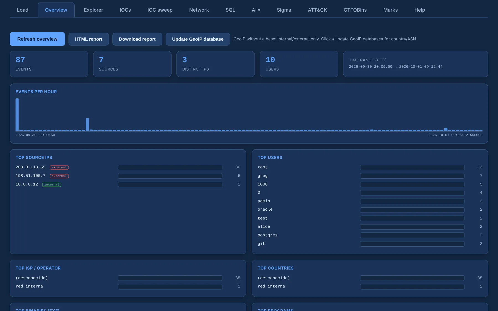

# Overview and GeoIP

The **Overview** is the case at a glance: event, source, IP and user counts, the time range,
events per hour, and the top source IPs, users, binaries (`exe`), programs and sources, plus
severity. Click a row to open the Explorer already filtered on it.

{ .shot }

## GeoIP

IPs are always tagged **internal** (RFC 1918, loopback, link-local) or **external** — no database
needed.

**Update GeoIP database** downloads the free **DB-IP Lite** databases once; from then on, offline,
public IPs also get their **country, ASN and ISP**, the top source IPs show **ASN · Org/ISP**
inline, and the Overview adds Top ISP and Top countries. On start, Longanizer refreshes them in the
background **only if they are missing or older than 30 days**, and stays silent without network.

Click any IP for its detail: first and last seen, authentication failures, a breakdown by source,
users and sample events, with **Open in Explorer**.

The same ASN · Org/ISP tags appear in the Explorer columns, the IOC extractor, the IOC sweep and
the Network tab.

## Report

**HTML report** opens the case report in a new tab and **Download report** saves it — see
[Marks and report](marks-report.md#report).
