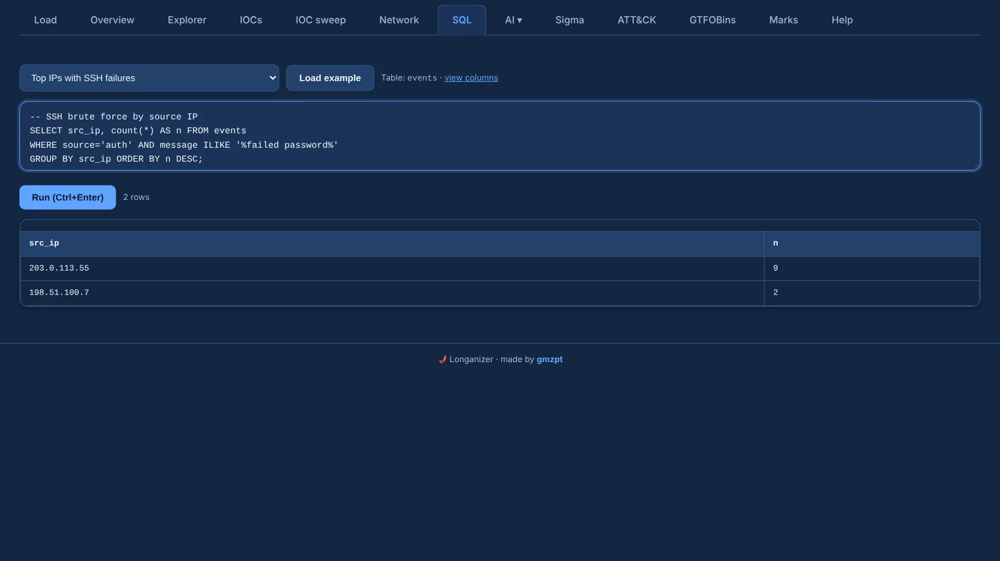

# SQL

The **SQL** tab runs read-only DuckDB SQL over the `events` table. Pick a ready-made query from the
dropdown and **Load example**, or write your own; **Run** (or Ctrl+Enter) executes it.

{ .shot }

- Only reads are allowed (`SELECT`, `WITH`, `DESCRIBE`, `SUMMARIZE`, `SHOW`, `PRAGMA`); the case
  can't be changed from here. Comments at the start (`-- …`) are fine.
- Source-specific fields (auditd `syscall`, `key`, `serial`, logfmt and CSV keys) live in the
  `extra` JSON column. Wrap it in parentheses inside expressions —
  `(extra->>'key') IS NOT NULL` — or use `json_extract_string(extra, '$.key')`.
- **view columns** lists every column; the [data model](../reference/data-model.md) explains them.

Typical filters:

```sql
WHERE source = 'auth' AND event IN ('ssh_failed', 'ssh_accepted')
WHERE src_ip = '203.0.113.55'
WHERE message ILIKE '%/etc/passwd%'
WHERE ts BETWEEN TIMESTAMP '2026-09-30 20:00:00' AND TIMESTAMP '2026-09-30 20:15:00'
WHERE source = 'access' AND status >= 400
```

More examples in [SQL recipes](../reference/sql-recipes.md).
